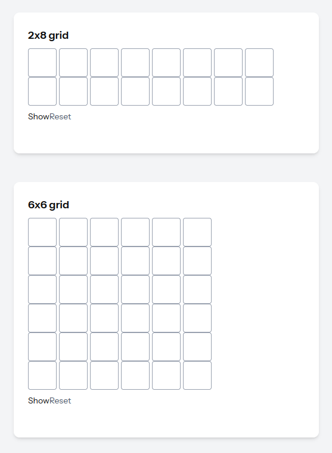

# Password2D — Multi-Dimensional Passwords for the Web

**Secure · Extensible · Framework-Friendly**

Password2D is an authentication innovation that replaces the classic single-line password with a **2-dimensional grid**, where characters are stored as:

```
(x, y) → value
```

This creates **significantly higher entropy**, even with short passwords, without changing backend password handling.



Password2D works everywhere:

* ✔ React
* ✔ Vue
* ✔ Angular
* ✔ Vanilla JS
* ✔ Any backend

---

## Why Password2D?

Traditional passwords = 1D:
`password123`

Password2D = **WHAT + WHERE**:
(0,1)pas(1,0)sw(2,1)o(4,2)rd1(6,0)23

")

")

Even with the same number of characters, Password2D drastically increases brute-force resistance because:

* Characters can be placed **anywhere** in the grid
* Multiple characters per cell
* Variable grid size
* Masking independent from cell logic
* Attackers must guess both **value AND coordinates**

For example:

```
Grid: 2 x 8
Max chars per cell: 2
Total positions: 16
Characters: 56 [a-Z0-9]

Instead of:
56^12 combinations  (regular 12-char password)

You get:
(16 positions)^12 × (56^12 char combinations)
≈ hundreds of orders of magnitude more entropy
```

Full analysis is in `/docs/security.md`.

---

## Packages

| Package                 | Description                       | Docs                                           |
| ----------------------- | --------------------------------- | ---------------------------------------------- |
| **@password2d/core**    | Core engine (pure TypeScript)     | [Core README](./packages/core/README.md)       |
| **@password2d/react**   | React UI + Hook (`usePassword2D`) | [React README](./packages/react/README.md)     |
| **@password2d/vue**     | Vue 3 component + composable      | [Vue README](./packages/vue/README.md)         |
| **@password2d/angular** | Angular standalone component      | [Angular README](./packages/angular/README.md) |
| **docs/**               | Technical documentation           | [Docs folder](./docs/)                         |

---

## Quick Demo (React)

```tsx
import { usePassword2D } from "@password2d/react";

export default function Login() {
  const [password, Grid] = usePassword2D({
    rows: 3,
    cols: 8,
    maxCharsPerCell: 2,
  });

  const submit = () => {
    // send password as normal string
    post("/login", { password });
  };

  return (
    <form onSubmit={submit}>
      <Grid />
      <button>Login</button>
    </form>
  );
}
```

Backend receives a classic string:

```
"(0,1)A(1,0)b(1,1)#..."
```

Hash it normally (bcrypt, argon2, etc.).

---

## Installation

Install only the package you need:

```bash
npm install @password2d/core        # if you want only the engine
npm install @password2d/react       # React
npm install @password2d/vue         # Vue 3
npm install @password2d/angular     # Angular 14+
npm install @password2d/vanilla
```

---

## Technical Documentation

More advanced material (architecture, API reference, extension design) lives in:

 `docs/`

* `architecture.md`
* `security.md`
* `ui-adapters.md`
* `engine-internals.md`

---

## Security

Password2D **does not replace standard hashing or encryption**.
It **enhances entropy before hashing**.

Grid → flattened string → backend password hashing (bcrypt/argon/…).

Full security analysis in `/docs/security.md`.

---

## Beyond 2D: Toward 3D and Behavioral Passwords

Extending the concept from a 2D grid to a 3D space — using coordinates (x, y, z) instead of (x, y) — could theoretically increase security by adding another dimension of entropy. However, this additional security comes with significant usability challenges.

A 3D password raises practical questions:
How should a cube be displayed? How does a user intuitively navigate depth? How do we ensure accessibility without overwhelming the user? Unlike a 2D grid, a 3D structure is harder to visualize, harder to input accurately, and more error-prone in everyday use.

That said, 3D interaction already exists in other domains such as video games and virtual environments. In those contexts, users do not “type” passwords — they move, react, and behave naturally. This opens the door to a different idea: **behavioral passwords**.

Instead of asking a user to explicitly enter a secret, a behavioral password relies on what the user does and how they do it — movement patterns, timing, choices, interactions, and habits — to continuously and implicitly identify them. In a true 3D or immersive environment, identity could be inferred from behavior rather than from a static credential.

While Password2D intentionally focuses on a balance between security and usability in today’s web applications, these ideas point toward a future where authentication may become continuous, passive, and deeply tied to user behavior rather than memorized secrets.


## License

MIT © 2025 — Password2D Team
